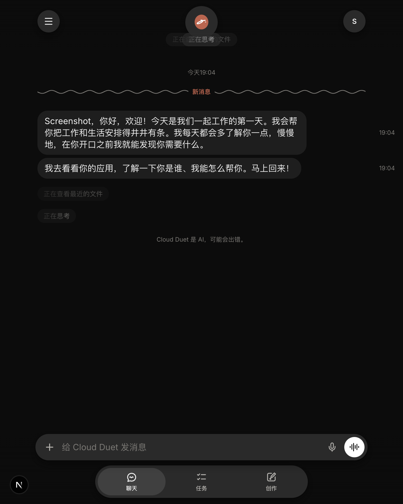
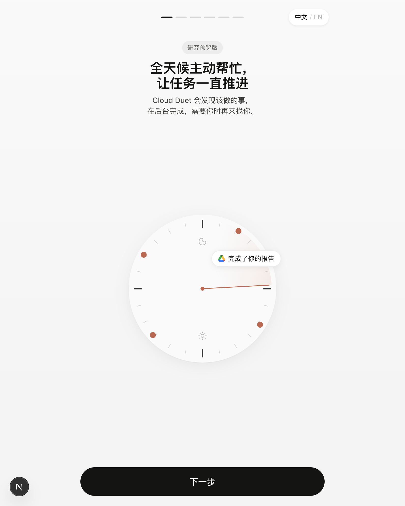
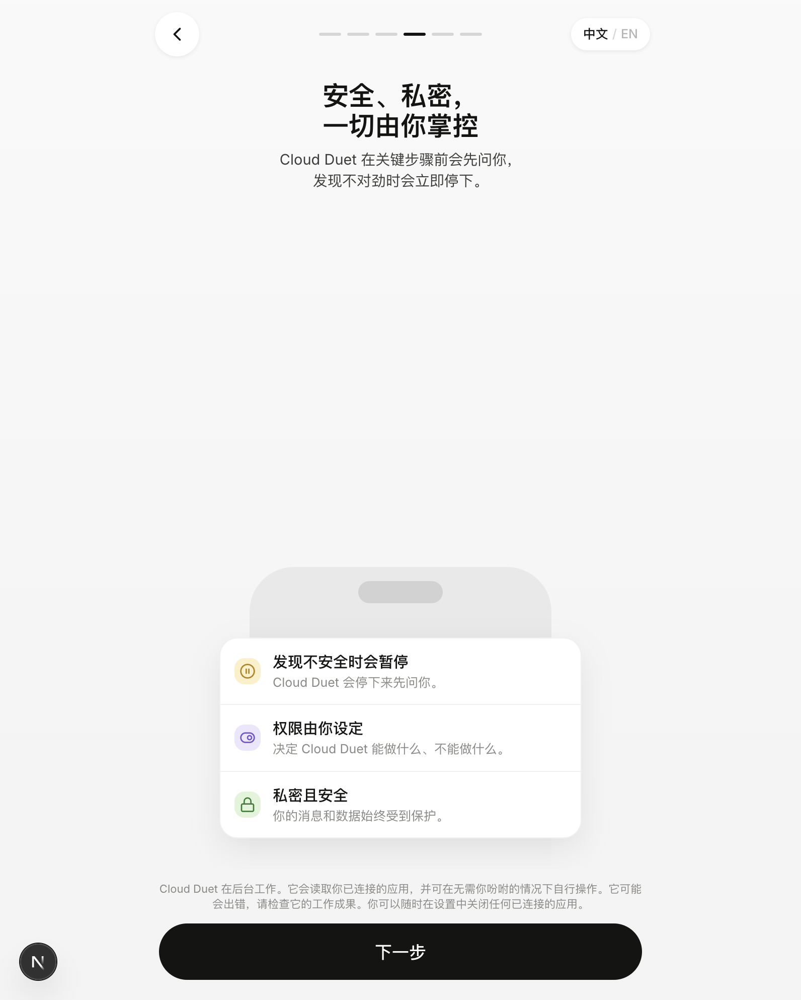
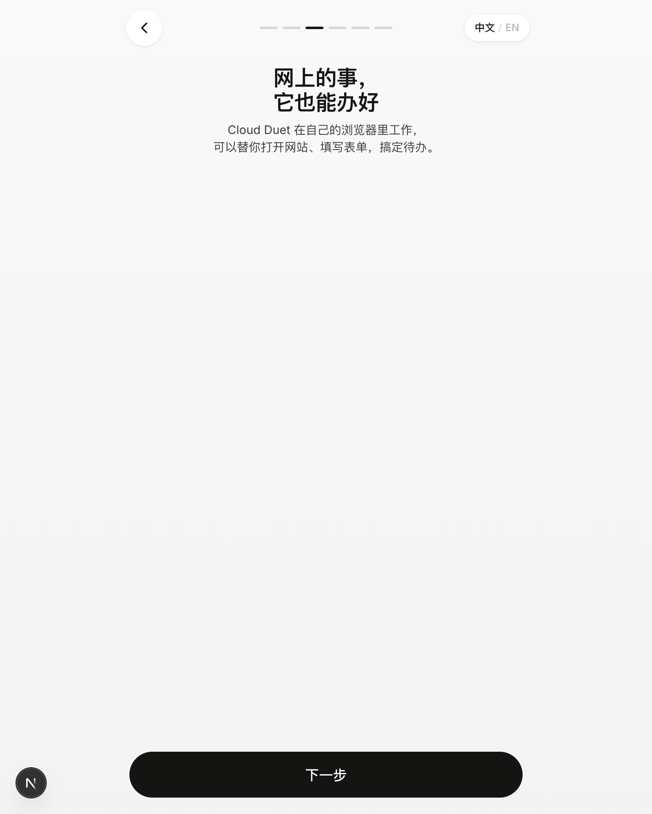

# Cloud Duet

开源的主动式 AI 工作助手：每天给你简报，在后台替你干活，发邮件、付款、提交表单之前一定先问你。界面默认简体中文，可在「资料 → 语言」切换为 English。

支持 QQ、微信、飞书、钉钉登录；可直连 QQ 邮箱 / 163 等邮箱、飞书、钉钉、企业微信、语雀与微信通知（Server酱 / PushPlus）；模型一键切换 DeepSeek、通义千问、Kimi、智谱、豆包、硅基流动、MiniMax，联网搜索可用博查。

涵盖引导页、聊天 / 任务 / 制作、审批、频道、连接器与设置，动效与交互均为手工打磨。未配置密钥时可完全离线运行内置**演示引擎**（虚构样例工作区 Northfield Studio）。填入模型密钥后由真实模型接管并自行调用工具；配置 Composio 后可操作真实 Gmail、日历、Drive、Slack 等；内置浏览器与手机通知无需额外密钥。

项目不内置任何密钥，均在应用内或 `.env.local` 中自行填写。

> 灵感来自 Anthropic Claude Duet 研究预览。独立项目，与 Anthropic 无隶属或背书关系。「Claude」为 Anthropic 商标。

<p align="center">
  
</p>

<p align="center">
  
  
  
</p>

## 快速开始

```bash
npm install
npm run dev
```

终端会打印访问地址；端口、域名与部署方式由你自行决定，本地、反代或任意可运行 Node 的平台均可。

可选密钥写在 `.env.local`（见 `.env.example`），或在应用内「资料 → 密钥与服务」填写。

Everyone signs in. Email + password works out of the box (a new email creates an account); Google and Apple appear once their OAuth clients are configured. Each account gets its own workspace in `data/users/<id>/` (git-ignored): state, model key, service keys and push subscriptions. The first account created inherits a pre-accounts `data/state.json`. Profile → **Reset demo workspace** starts over; long-press your initials (top right) to replay onboarding.

## Running it for other people

The first account to sign in owns the server. Keys in `.env.local` only work for the owner (and anyone in `SHARED_KEYS_FOR`); everyone else brings their own keys in the app. Set `ALLOW_SIGNUP=false` or `ALLOWED_EMAILS` to control who can register, set `PUBLIC_URL` to the address people use, and `TRUST_PROXY=1` only behind your own reverse proxy. Sessions can be revoked (signing out ends them on the server), sign-in is throttled, and the built-in browser can't reach private network addresses unless `BROWSER_ALLOW_PRIVATE=1`.

## Keys & services

| Service | What it turns on | Where to get it | Where it goes |
| --- | --- | --- | --- |
| Model | Real replies and the tool loop | [Anthropic](https://console.anthropic.com/settings/keys) or [OpenAI](https://platform.openai.com/api-keys) / any compatible endpoint | Profile → Model & API key, or `ANTHROPIC_API_KEY` / `OPENAI_API_KEY` |
| Composio | Real Gmail, Calendar, Drive, Slack, Stripe, GitHub, HubSpot… | [platform.composio.dev](https://platform.composio.dev) | Profile → Keys & services, or `COMPOSIO_API_KEY` |
| Bocha / Tavily | `search_web` for models without their own search (DeepSeek, Qwen, Kimi…) | [open.bochaai.com](https://open.bochaai.com/) · [app.tavily.com](https://app.tavily.com/) | Keys & services, or `BOCHA_API_KEY` / `TAVILY_API_KEY` |
| Browserbase | Cloud browser with a live view link | [browserbase.com/settings](https://www.browserbase.com/settings) | Keys & services, or `BROWSERBASE_API_KEY` + `BROWSERBASE_PROJECT_ID` |
| Google sign-in | "Continue with Google" | [Google Cloud credentials](https://console.cloud.google.com/apis/credentials) (Web application, redirect `<origin>/api/auth/google/callback`) | `GOOGLE_CLIENT_ID`, `GOOGLE_CLIENT_SECRET` |
| Apple sign-in | "Continue with Apple" | [Services ID](https://developer.apple.com/account/resources/identifiers/list/serviceId) + [key](https://developer.apple.com/account/resources/authkeys/list) (paid developer account, return URL `<origin>/api/auth/apple/callback`) | `APPLE_CLIENT_ID`, `APPLE_TEAM_ID`, `APPLE_KEY_ID`, `APPLE_PRIVATE_KEY` |
| QQ sign-in | QQ button on sign-in | [QQ Connect](https://connect.qq.com/manage.html) website app (ICP-registered domain, callback `<origin>/api/auth/qq/callback`) | `QQ_APP_ID`, `QQ_APP_KEY` |
| WeChat sign-in | WeChat QR-code sign-in | [WeChat Open Platform](https://open.weixin.qq.com/) verified website app (authorized domain = your host) | `WECHAT_APP_ID`, `WECHAT_APP_SECRET` |
| Feishu sign-in | Feishu button on sign-in | [Feishu Open Platform](https://open.feishu.cn/app) custom app, redirect `<origin>/api/auth/feishu/callback` | `FEISHU_APP_ID`, `FEISHU_APP_SECRET` |
| DingTalk sign-in | DingTalk button on sign-in | [DingTalk Open Platform](https://open-dev.dingtalk.com/) app, callback `<origin>/api/auth/dingtalk/callback` | `DINGTALK_CLIENT_ID`, `DINGTALK_CLIENT_SECRET` |
| Push notifications | System notifications on desktop and phone | Nothing: VAPID keys are generated into `data/vapid.json` | Profile → Notifications |

- **Connectors.** With Composio set, tapping Connect on an app opens its real OAuth page and returns to `/api/connectors/<id>/callback`. Connected apps show "Your real account"; the model gets `app_find_actions` / `app_run_action` for them, and the sample tools for that app step aside. Anything that writes (send, create, delete…) goes through an approval card first. Without Composio, Connect links the sample data.
- **Apps popular in China (国内常用).** These need no Composio and no server setting: each person fills in a form on the connector page (tap the mascot → 国内常用). Saving tests the connection first; credentials stay in `data/users/<id>/direct.json` (mode 600) and only their last four characters are ever shown again.
  - **QQ 邮箱 / 163 等**: the address plus an *auth code* (授权码, not the login password) from the mailbox's POP3/IMAP/SMTP settings. Servers are filled in for QQ Mail, NetEase 163/126/yeah, Tencent Exmail, NetEase Qiye, Aliyun, Sina, Sohu, 139, iCloud and Gmail app passwords; anything else can be entered by hand. The model gets `mailbox_list`, `mailbox_read` and `mailbox_folders`, and `draft_email` sends from this mailbox.
  - **飞书 Feishu**: a custom app's App ID and App Secret (bot feature plus `im:message` and `im:chat` permissions) lets the model list the bot's chats, read them and send messages; a custom group bot webhook (with optional signing secret) posts to one group.
  - **钉钉 DingTalk** and **企业微信 WeCom**: a group bot webhook (DingTalk with the optional 加签 secret) for posting updates and reminders.
  - **微信通知 WeChat notifications**: a Server酱 SendKey or PushPlus token. The model gets `wechat_notify`, and app notifications (reminders, finished tasks, approvals) can go to WeChat too.
  - **语雀 Yuque**: a personal or team token. The model can search, list and read docs, and save new ones.
  - Every send shows an approval card unless the person sets that tool to Always (WeChat notifications to yourself default to Always).
- **The built-in browser.** Browser tasks drive a real Chrome through Playwright: Browserbase when its key is set, otherwise Chrome on this server (`CHROME_PATH`). The model reads pages as numbered controls, posts screenshots to the task, asks for logins with the sign-in card (the password is typed into the page and never stored or shown to the model) and clicks final submit buttons only after approval. Idle browsers close after 15 minutes.
- **Files.** The + menu (or paste) uploads files up to 15 MB into `data/users/<id>/files/`. Images and PDFs go to the model as real content; text files go in as text. Only the four most recent attachments are sent in full.
- **Share links.** Share on a dashboard creates a read-only public link at `/s/<token>` (no sign-in, not indexed, sandboxed by a strict CSP). Tokens live in `data/shares.json`; unsharing revokes them.
- **Push.** Turning on notifications registers `public/sw.js` and subscribes the device. On iPhone, add Duet to the Home Screen first (Share → Add to Home Screen); the app ships a web manifest and icons. OAuth and push need https, so behind a tunnel set `PUBLIC_URL` if redirects come back on the wrong host.

## What's in it

- **Six-page onboarding, then sign-in**: the 24-hour clock dial with its trailing wedge and rim pulses; apps flying along a dotted arc into Duet, followed by a check badge; the agent's cursor filling a form in its own browser; the safety card; Slack; notifications; then the orange check celebration (a wavy line that tucks into a check, plus a burst of strokes). Sign-in is the next screen.
- **Mascot**: a single 72-point path that morphs per frame between moods (idle wave, working, tasks zigzag, cursive "ee" while writing, dash plus dot while thinking, Saturn ring while searching, speed streaks when starting, listening). The circle bobs and squashes.
- **Chat**: live status pill, typing dots, quick replies, long-press reactions, swipe left for timestamps, a "New" squiggle divider, spawned-task chips, and cards (email / payment / sign / delete approvals with inline edit and a glow highlight, plate, suggestions, a swipeable proactive card, artifacts with a metric ticker, skills, confirmations, alerts, usage limits).
- **Tasks**: Active / Up next, status groups, routines with run history and Run now, and a slide-in task detail with steps, updates, resources and its own thread.
- **Make**: a hero with a typewriter prompt, a fan-out FAB, a build view with a tracing perimeter and live statuses, an artifact viewer (dashboards, docs, slides, web pages, designs) and pinning to the tab bar.
- **Side menu, channels and sheets**: the side menu pushes the app aside, plus channels with an icon/colour picker, the access sheet, connector tool policies (Ask / Always), profile, usage with the free reset, memory, notifications, payments, and Model & API key.
- **Voice mode** (Web Speech API) and in-app notification banners (plus system notifications when the tab is hidden).

## Language

Copy is written in English in the code and translated through `src/lib/i18n/` (`zh/*.ts` dictionaries keyed by the English text, so a missing entry falls back to English). The browser keeps the choice in `localStorage`; the server keeps a copy in the account's settings so its own replies, notes and the model's replies follow it. To add a language, add a dictionary and a `Lang` entry.

## Model / API key

The model hook is reserved, not required.

- In the app: Profile → **Model & API key**. Pick Anthropic or any OpenAI-compatible endpoint, paste a key, and optionally set the model and base URL. **Quick setup** fills in DeepSeek, Qwen (Bailian), Kimi, Zhipu GLM, Doubao (Ark), SiliconFlow, MiniMax or OpenAI. **Test** does a one-token round trip.
- Or set environment variables: `ANTHROPIC_API_KEY`, or `OPENAI_API_KEY` (+ `OPENAI_BASE_URL`).

Keys are stored server-side in `data/users/<id>/model.json` (mode 600) and never sent to the browser. If a model call fails, that reply falls back to the demo engine with a grey note.

### What the model can do

With a key set, chat replies, task threads and started suggestions run through a tool loop (`src/lib/server/agent/`). The model decides which tools to call, the app shows the matching live status ("Searching your email", "Checking memory"…), and results go back to the model until it's done (up to 12 turns).

| Tool | What it does |
| --- | --- |
| `search_email`, `read_calendar`, `search_files`, `list_invoices` | Read the sample workspace. Each needs its connector connected. |
| `check_memory`, `search_past_chats`, `remember` | Memory, skills, open tasks, pending approvals, earlier messages. |
| `set_reminder` | Posts and notifies at the given time. |
| `draft_email`, `revise_draft` | An approval card, or a send when Gmail's Send email is set to **Always**. |
| `request_payment` | A Link payment approval (test mode by default). |
| `use_browser` | Starts a browser task, which gets `browser_open`, `browser_look`, `browser_click`, `browser_type`, `browser_scroll`, `browser_request_login` and `browser_submit`. |
| `app_find_actions`, `app_run_action` | Real connected apps through Composio; writes need approval. |
| `mailbox_list`, `mailbox_read`, `mailbox_folders` | The connected QQ / 163 / IMAP mailbox. |
| `wechat_notify`, `yuque_search`, `yuque_list`, `yuque_read`, `yuque_create_doc` | WeChat notifications and Yuque. |
| `search_web` | Bocha or Tavily web search, for models other than Anthropic's own API. |
| `feishu_list_chats`, `feishu_read_messages`, `feishu_send_message`, `dingtalk_send_message`, `wecom_send_message` | Feishu, DingTalk and WeCom; sends need approval. |
| `start_task` | A background task that runs its own loop with `set_steps`, `update_progress`, `add_link` and `finish_task`. |
| `make_artifact` | Docs written by the model in markdown, or dashboards, decks, pages and designs. |
| `propose_task`, `suggest_tasks`, `quick_replies` | Cards and tappable replies. |
| `web_search` | Anthropic's server-side web search, on api.anthropic.com only. |

Every call passes the guardrails first (no trading, no moving money, no card or SSN numbers leaving the app). Sending, paying and submitting always wait for the person's OK, unless they set that tool to Always. Approving a draft inside a model-run task resumes the task so the model can wrap it up. Apps that aren't connected through Composio keep using the fictional sample workspace. When Gmail is real, approving an email draft sends it from the person's Gmail.

HTTP interface:

| Method | Path | Body |
| --- | --- | --- |
| `GET` | `/api/model` | → `{ provider, model, baseURL, hasKey, keyHint }` |
| `PUT` | `/api/model` | `{ provider?: "anthropic" \| "openai", apiKey?, model?, baseURL? }` |
| `DELETE` | `/api/model` | clears the saved key |
| `POST` | `/api/model/test` | → `{ ok, error?, ms }` |

To add another model backend, write an adapter next to `anthropic()` and `openai()` in `src/lib/server/agent/loop.ts`.

## Layout

```
src/app/api/[...path]/route.ts   every action (REST-ish, per signed-in account)
src/app/api/auth/[...path]/      email, Google and Apple sign-in, sign-out
src/app/api/events/route.ts      server-sent events stream
src/lib/server/                  store, event bus, guardrails, demo engine, provider
src/lib/server/{auth,context}.ts accounts, sessions, per-account data
src/lib/server/composio.ts       real apps
src/lib/server/browser.ts        the agent's browser (Playwright)
src/lib/server/push.ts           Web Push
src/lib/server/agent/            the model's tool loop and its tools
src/lib/client/store.ts          zustand store fed by SSE
src/components/duet/             UI: chat, tasks, make, onboarding, sheets, mascot
```

## Credits

Built with Next.js, Tailwind, shadcn/ui, motion and zustand. The architecture and guardrails draw on [Studio1-OSS/OpenDuet](https://github.com/Studio1-OSS/OpenDuet) and [hmody1m/covo](https://github.com/hmody1m/covo) (both MIT).

## License

MIT. See [LICENSE](LICENSE).
